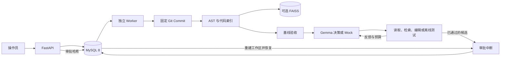

# PatchPilot

PatchPilot 是一个面向 Gemma 4 31B 的单 Agent 代码修复平台。它将 GitHub Issue 描述与固定的仓库 Commit 交给 Worker，检索代码、产生补丁并在离线容器中测试，最后把验证过的候选交给人工审批。默认可以零费用运行一个公开仓库的 Mock 演示。

## 本地启动

需要 Git、Python 3.12、uv、Docker Engine 和 Docker Compose v2。

```sh
uv sync --frozen
cp -n .env.example .env
python3 -c 'import secrets; print("\n".join(secrets.token_hex(24) for _ in range(3)))'
```

将生成的三个十六进制字符串分别填入 `.env` 的 `PATCHPILOT_DB_PASSWORD`、`PATCHPILOT_ROOT_PASSWORD` 和 `PATCHPILOT_API_TOKEN`。接着执行：

```sh
docker build -f Sandbox.Dockerfile -t patchpilot-sandbox:local .
docker compose up --build -d
docker compose ps
uv run python scripts/demo.py --approve
```

在 [FastAPI 接口文档](http://127.0.0.1:8080/docs) 点击 **Authorize**，输入 `PATCHPILOT_API_TOKEN`。可在 Swagger UI 中逐步导入仓库、提交任务、查看补丁并审批。Compose 将 API 绑定到本机回环地址，MySQL 仅在 Compose 网络内可达。独立 GPU 服务按需接入。

## 公开演示

演示基于 [PyPA sampleproject 的固定 Commit](https://github.com/pypa/sampleproject/tree/621e4974ca25ce531773def586ba3ed8e736b3fc)。合成需求是为 `add_one` 增加默认参数，同时保留显式传参行为。独立验收脚本检查默认调用和两个显式参数。预期序列为：

1. 固定的基线测试退出码为 `1`，证明演示需求在基线上未满足。
2. Mock 依次读取源文件、提交定向编辑、运行同一验收脚本并请求审批。当前补丁应通过测试，退出码为 `0`。
3. 审批绑定补丁及基线 Commit 的 SHA-256。Worker 从 MySQL Checkpoint 恢复，重新构造候选工作区，最后标记 `succeeded`。SSE 可用最后一个事件 ID 继续读取。

省略 `--approve` 可停在待审批状态，用 `POST /jobs/{id}/approval` 手动审批。Mock 是针对该演示需求编写的脚本化模型，能检验工作流，不能作为模型效果指标。

## 工作流



| 路径 | 内容 |
| --- | --- |
| `patchpilot/model.py` | Mock 与本地 OpenAI 兼容 Gemma 客户端。用精确的 served ID 选择 Base 或 LoRA |
| `patchpilot/graph.py`、`workspace.py` | 单 Agent StateGraph、动作预算、Git Commit 固定、工作区重建与审批 |
| `patchpilot/rag.py` | Python AST 符号及其他文本语言的行片段，LangChain Document、关键词检索、可选本地向量及 FAISS |
| `patchpilot/api.py`、`worker.py` | 带 Bearer 认证的 FastAPI、异步队列、SSE、Worker 互斥、重试与持久恢复 |
| `patchpilot/sandbox.py`、`Sandbox.Dockerfile` | 无网络、无宿主挂载的临时 Python 测试容器 |
| `migrations/`、`compose.yaml` | MySQL 8.4、Alembic 迁移、本地 API 与 Worker |
| `workflows/rs_sft/` | 原 Google ADK 配置、官方工具及 Harness、轨迹记录、拒绝采样、SFT/QLoRA、Base/LoRA 评估 |
| `experiments/` | [历史脱敏实验记录](experiments/README.md)与独立的 edit-recovery 实验 |
| `platform_tests/`、`scripts/` | 平台单元测试、MySQL 接口与恢复集成测试、容器隔离测试及公开仓库演示 |

## API

| 方法和路径 | 用途 |
| --- | --- |
| `POST /repositories`、`GET /repositories` | 注册 GitHub HTTPS 仓库，查询已注册仓库 |
| `POST /jobs` | 将 `repository_id`、40 位 `commit`、`issue`、`model_mode` 和 `profile` 交给 Worker。首次执行拉取固定 Commit |
| `GET /jobs`、`GET /jobs/{id}` | 查询历史与任务状态 |
| `GET /jobs/{id}/events` | SSE 节点与状态事件。支持 `Last-Event-ID` 或 `?after=` |
| `GET /jobs/{id}/patch` | 获取候选 Git diff 和基线 Commit。待审候选带 `X-Patch-SHA256` |
| `POST /jobs/{id}/approval` | 提交布尔值 `approve` 和当前 `patch_sha` |
| `POST /jobs/{id}/retry` | 将失败任务重新入队，从同一持久状态重试 |

[平台配置、表结构与运行说明](docs/platform.md) · [原 ADK 与后训练依赖](docs/dependencies.md)
